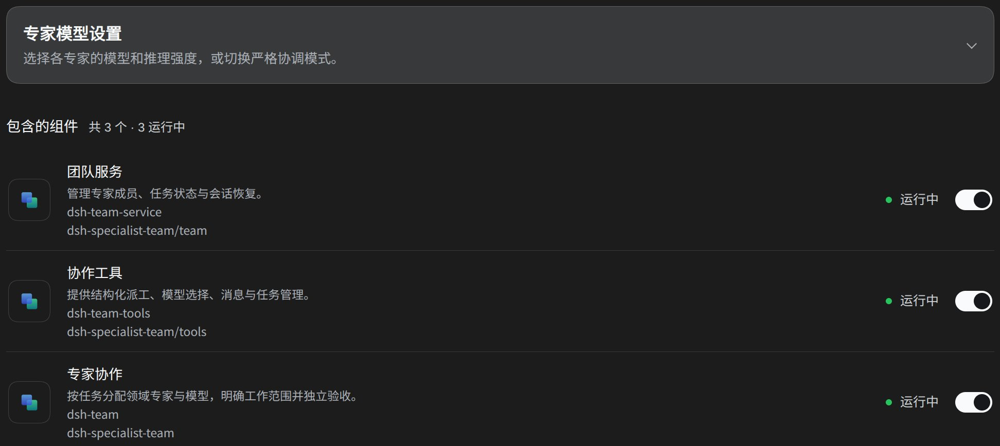

# dsh-specialist-team

English | [简体中文](README.zh-CN.md)

Ask DSH to delegate part of a task to a specialist. For example, have an engineer make a change and a separate verifier run the checks. Specialists appear in the same Agent Teams view as ordinary teammates.

## Install and try it

### Prerequisites

- **Versions.** DSH `0.2.2-rc.4` and Node.js `>=22`.
- **DSH plugins.** DSH’s Subagent plugin (`@deepseek-ai/dsh-subagent`) and Agent Teams plugin (`@deepseek-ai/dsh-agent-team`) come with DSH and are enabled by default. You do not install them, but keep both enabled: this plugin stays inactive without them.
- **Agent Teams on.** Agent Teams is off by default in each conversation. In the main (top-level) conversation, select **Use Agent Teams** in the model and reasoning menu before you ask for a specialist. Otherwise the specialist tools are not offered, and the main agent works itself or starts an ordinary teammate.
- **DSH Web.** The plugin’s settings page is part of the DSH Web interface, and the install command below uses the `web` profile.

### Steps

1. Open the [latest release](https://github.com/p33333333333333l/dsh-specialist-team/releases/latest). Under **Assets**, copy the `.tgz` link into DSH’s plugin manager. To install from the command line, replace `PACKAGE_URL` with that link and change `web` if you use a different profile.

   ```sh
   dsh plugin --profile web add PACKAGE_URL
   ```

2. Reload DSH if the plugin manager reports a pending change. Open a main conversation with **Agent Teams** on.
3. Send a request like the one below. If a researcher starts, its name appears in the team view, for example `researcher-read-docs`.

   > Ask a researcher to read only the project README and summarize what the project does in one sentence.

## Tell DSH what to delegate

Say what result you want and mention any files the specialist may read or edit. For a code change, for example, you can ask an engineer to edit a specific file and a verifier to run a specific check.

| Ask for a… | When you want to… |
| --- | --- |
| Designer | Design an interface or change the assigned UI. |
| Researcher | Find sources or check evidence using read-only tools. |
| Engineer | Implement a change or write tests. |
| Architect | Diagnose a problem or compare approaches using read-only tools. |
| Verifier | Review the result independently or run the assigned checks. |

A specialist starts with a fresh conversation by default. Include any findings or constraints it needs in your request.

Every specialist and coordinator started through the plugin gets a card on the task board, assigned to it, so no task is left without an owner. The plugin completes the card when the member reports a delivery or a passing check.

For a regression, ask the main agent to put three stages on the task board: a verifier reproduces the failure, an engineer fixes it, and a separate verifier retests it. Each specialist reports under its task ID. The next task becomes ready when the main agent reviews the result and completes the current card.

For work that splits into independent groups, ask the main agent to “use multi-level dispatch for this task and have each group coordinator assign specialists and summarize their results.” This needs a subagent depth of at least 2 and at least two shared active slots, but DSH’s default depth is 1. Raise `maxDepth` first (the link below shows how); a deeper subagent depth allows sub-coordinators. With full-power mode on (below), the main agent dispatches this way by default and raises these limits itself. [Multi-level dispatch and recovery](docs/advanced.md#multi-level-dispatch)

## Choose a specialist model

In DSH Web, open **Plugins → Specialist Team → Specialist model settings**. Select a provider and model for the role you want to configure. Changes save automatically and apply when new specialists start. With no role preference or model specified in the request, the specialist uses the main agent’s model.



If DSH rejects the model, check that **Subagent settings** allows model selection and that the exact provider and model are on the allowed list. After changing the list, try in a new main conversation. To clear a saved reasoning effort while keeping the model, select **No effort preference**.

## Hand over a goal: full-power mode

To give the team a goal and get on with other work, turn on **Full-power mode** in **Specialist model settings**. For everyday work, leave it off; the main agent can then work directly and delegate as needed.

Before you turn it on:

- Agent Teams must be on in the main conversation, because the mode only takes effect there. DSH’s Subagent plugin must be active, or the limits below are not raised.
- The main agent keeps only dispatch and coordination tools and uses native tool calls instead of Programmatic Tool Calling (PTC). To get PTC back, turn the mode off and reopen the conversation ([details](docs/advanced.md#restore-programmatic-tool-calling)).

While it is on:

- The main agent only splits and dispatches work and does not read or write files itself. Group coordinators split their groups further and keep as many specialists working at once as they can.
- The plugin raises the live subagent depth to 3 and the number of subagents running at once to 100. Higher values you set are kept. Your own values come back when you turn the mode off or disable the plugin.
- Specialists and coordinators take questions to their direct superior first, and questions move up level by level. The main agent asks you only when the goal is unclear, an irreversible or external action lacks your approval, or credentials are needed.
- Commits and pushes happen only if you have authorized them. An independent verifier runs the exact git commands the main agent assigns.

More specialists run at once, so model costs rise. Turn the mode off before uninstalling the plugin; otherwise the main agent in already open conversations stays limited to dispatching.

## If a specialist doesn’t start

- **You see an ordinary teammate.** Ask the main agent to retry with a specific specialist role and task. Agent Teams can display ordinary teammates and specialists together.
- **Creation fails with a model error.** Check the model permissions above if you chose a custom model. If DSH asks for a provider or model when you didn’t specify one, update the plugin using the installation steps above and retry.
- **An existing specialist stops using tools after the plugin is disabled.** Re-enable the plugin so that it can continue under its original assignment.

For direct tool calls, manual configuration, and source verification, see the [advanced reference](docs/advanced.md).

[Apache-2.0 license](LICENSE) · [Attribution notice](NOTICE)
