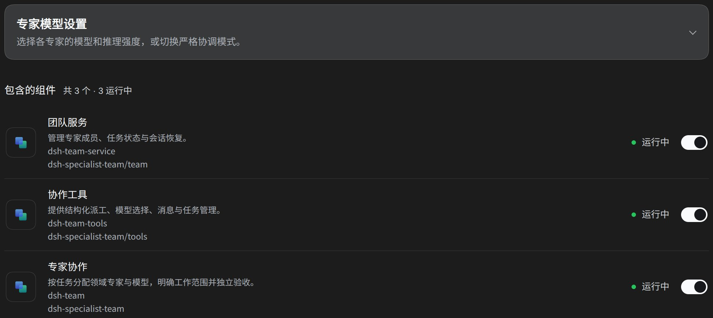

# dsh-specialist-team

[English](README.md) | 简体中文

把任务的一部分交给 DSH 专家。比如让工程师改代码，再请另一位验收员跑检查。专家和普通队友都会显示在 Agent Teams 的团队列表里。

## 安装并试用

### 使用前提

- **版本。** DSH `0.2.2-rc.4`，Node.js `>=22`。
- **DSH 插件。** DSH 的子代理插件（`@deepseek-ai/dsh-subagent`）和 Agent Teams 插件（`@deepseek-ai/dsh-agent-team`）随 DSH 提供，默认已启用，不需要另外安装。请保持两者启用，缺少任何一个，本插件都不会工作。
- **开启 Agent Teams。** Agent Teams 对每个新的主会话（最上层的会话）默认关闭，其设置覆盖该会话的整棵代理树。请在主会话的模型与推理菜单里选择 **启用智能体团队协作**，再请专家出手；否则不会提供专家工具，主代理只能自己动手，或启动普通队友。
- **DSH 网页端。** 本插件的设置页在 DSH 网页端里，下面的安装命令也使用 `web` 配置。

### 步骤

1. 打开[最新发行页](https://github.com/p33333333333333l/dsh-specialist-team/releases/latest)，在 **Assets** 下复制 `.tgz` 链接，粘贴到 DSH 插件管理器。用命令行安装时，把 `PACKAGE_URL` 换成该链接。如果你用的是其他配置（profile），也把 `web` 换成对应的配置名。

   ```sh
   dsh plugin --profile web add PACKAGE_URL
   ```

2. 如果插件管理器提示有待应用的变更，先重新加载 DSH。打开已开启 **Agent Teams** 的主会话。
3. 发送下面这句话试试。研究员启动后，会出现在团队列表里，例如 `researcher-read-docs`。

   > 请让研究员只读项目的 README，用一句话告诉我这个项目是做什么的。

## 怎么交代任务

说清楚你要的结果，以及哪些文件可以读或改。比如请工程师只修改指定文件，再请验收员运行你指定的检查。

| 请谁 | 适合做什么 |
| --- | --- |
| 设计师 | 设计界面和交互，或修改指定的界面。 |
| 研究员 | 只读查找资料、核对证据。 |
| 工程师 | 实现改动、编写测试。 |
| 架构师 | 只读排查问题、比较方案。 |
| 验收员 | 独立检查结果，或运行指定的检查。 |

专家默认从新会话开始。派工时一并说清它需要知道的前情和限制。

每个通过插件启动的专家和组长，都会在任务板上有一张指派给自己的卡，看板上不会出现没人负责的任务。成员报告交付或检查通过后，插件自动完成这张卡。

遇到回归问题，可以请主代理在任务板上安排「验收员复现 → 工程师修复 → 另一位验收员复测」。专家的回执带有对应的任务编号，主代理确认该阶段交付后完成任务卡，下游任务才会就绪。

任务能拆成独立工作组时，可以对主代理说「这次用多级派工，每组由组长派专家并汇总结果」。子代理深度和活动名额都至少要为 2，而 DSH 默认的子代理深度是 1，需要先调高 `maxDepth`（做法见下面的链接）；子代理深度更大时，组长可以再开下级组长。开启下面的火力全开模式后，主代理默认这样派工，并自行调高这些上限。[多级派工与故障恢复](docs/advanced.zh-CN.md#多级派工)

## 给专家选择模型

在 DSH 网页端打开 **插件 → 专家团队 → 专家模型设置**，为需要单独配置的角色选择提供方和模型。设置会自动保存，对之后启动的专家生效。如果该角色和本次派工都没指定模型，就沿用主代理的模型。



如果 DSH 拒绝所选模型，检查子代理设置里是否允许选择模型，以及允许列表里是否包含这个提供方和模型的组合。改完允许列表后，在新的主会话里重试。想清除已保存的推理强度并保留模型时，选择**不指定推理强度**。

## 只交代目标：火力全开模式

想把一个目标交给团队、自己去忙别的，就到**专家模型设置**开启**火力全开模式**。日常使用保持关闭即可，主代理能自己做事，也能按需派工。

开启前请确认：

- 主会话里已开启 Agent Teams，该模式只在那里生效；DSH 的子代理插件处于启用状态，否则下面的上限不会被调高。
- 主代理只保留派工和协调类工具，并改用原生工具调用，不再使用程序化工具调用（PTC）。关闭该模式时，本插件不会恢复 PTC（[详见](docs/advanced.zh-CN.md#恢复程序化工具调用)）。

开启后：

- 主代理只拆分和派发任务，自己不读写文件。各组组长继续往下拆分，尽量让底层专家同时工作。
- 主代理会持续推进到目标达成：每次有成员交付后重新盘点，立即派出所有就绪任务；全部完成后，再派独立验收员或架构师查缺陷和可改进处，没有新发现才收尾。
- 插件在运行时把子代理深度提高到 3、同时运行的子代理提高到 100。你设得更高的值不变。关闭该模式或停用插件后，恢复你原来的值。
- 专家和组长遇到问题先问直属上级，逐级往上转。只有目标不清、不可逆或对外的操作没获授权、需要凭据时，主代理才会问你。
- 只有你授权后才会提交和推送，由独立的验收员执行主代理指定的 git 命令。

同时运行的专家更多，模型费用也会更高。卸载插件前先关闭该模式，否则已打开会话里的主代理会一直只能派工。

## 专家没有启动怎么办

- **团队里出现的是普通队友。** 请主代理指定专家角色和任务后重试。Agent Teams 的列表里可以同时有普通队友和专家。
- **创建时提示模型错误。** 如果选过模型，先检查上面的模型权限。如果没指定模型却提示缺少提供方或模型，按上面的安装步骤更新插件后再试。
- **停用插件后，正在工作的专家无法继续使用工具。** 重新启用插件，专家就能按原派工权限继续。

需要直接调用派工工具、手动配置或验证源码时，见[进阶参考](docs/advanced.zh-CN.md)。

[Apache-2.0 许可证](LICENSE) · [版权归属声明](NOTICE.zh-CN)
